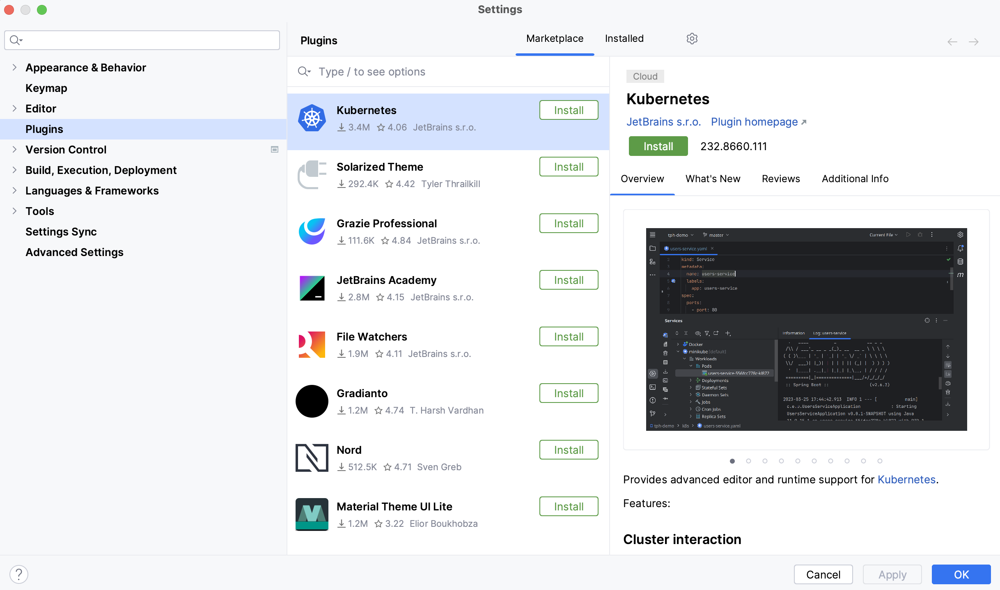
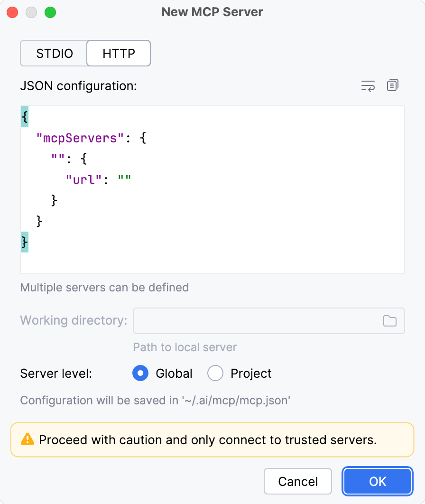

# Suno by Ace Data Cloud：中文完整教程

[English](README.md)

Ace Data Cloud 提供的独立 Suno music 集成，并非 Suno 或 JetBrains 官方插件。复用已有 Ace 服务和计费，不新增模型或价格。

## 1. 从官方入口安装

打开[JetBrains 官方安装或搜索入口](https://plugins.jetbrains.com/plugin/30782-suno-mcp)；在 IDE 中进入 **Settings → Plugins → Marketplace**，搜索 **Suno** 并核对发布者 **AceDataCloud**。已有官方市场条目；本教程描述的新原生面板仍待新版本批准发布。当前旧版不能视为已经包含该面板。



图片来自 [JetBrains 插件安装文档](https://www.jetbrains.com/help/idea/managing-plugins.html)，2026.2 官方资源，2026-10-18 下载核验，原始拍摄日期未披露。图中为其他插件的真实安装入口，不是本服务已安装或调用成功的截图。

新版本批准发布后打开 **Settings → Tools → Suno MCP → Suno**。这是新原生服务页签，不需要 AI Assistant 或 uv；原生面板的实际 GUI 截图尚待验收，不用官方空白图冒充新界面。

## 2. 注册、登录并取得专用 API Token

1. 打开 [Ace Data Cloud → Applications](https://platform.acedata.cloud/console/applications?utm_source=jetbrains_marketplace&utm_medium=referral&utm_campaign=evergreen&utm_content=suno_mcp_jetbrains_api_key)，先注册或登录自己的 Ace 账号。
2. 找到 **General application**。尚未初始化时选择 **Initialize General Application**；通用应用 Key 可使用账号已开放的服务，专用应用 Key 受其服务范围限制。确认 Suno 的服务/模型权限，并查看[当前模型与价格](https://platform.acedata.cloud/models?utm_source=jetbrains_marketplace&utm_medium=referral&utm_campaign=evergreen&utm_content=suno_mcp_jetbrains_models)，不要使用旧文章的报价或假定有免费额度。
3. 在应用卡片复制 **API Key**；或进入 **Keys / Manage Keys → Create**，创建一个独立命名的 Key，例如 `suno-jetbrains`，便于单独撤销、轮换和核对使用。
4. 创建时检查 **Expiration Time、Set Usage Limitation、Allowed APIs**。仅开放自己需要的操作；只允许任务查询不代表允许生成。检查应用当前余额能覆盖准备提交的请求，再点 Create 并从 Key 列表复制 Token。
5. 只复制原始 Token，不要带引号、空格或 `Bearer `。`platform-...` 是账号管理 Token，不能替代本服务生成 API Key；仅手动配置 HTTP Authorization 时加 `Bearer ` 前缀。


两张 Key 图复用既有 Dify 仓中的真实平台教程截图，固定于提交 `2522b2f57210597af2db866445319334a1677a23`；2026-10-18 复用，原始拍摄日期未记录。它们用于说明平台操作，不证明本插件已运行或产生注册/付费。

## 3. 在本平台填写 Key

在 **Tools → Suno MCP → Suno** 的 **Application API Key** 密码框粘贴原始 Key。新原生页签的 Key 仅留内存，关闭设置页后清空。不要把 Key 放进提示词、截图、共享项目或 Git。

第二个 **AI Assistant MCP (optional)** 页签是另一条可选配置路径，旧 helper 的独立 Key 仍采用原有本地存储；不要把这个旧行为误解为新原生面板保存了 Key。

## 4. 首次使用：先查模型，再明确提交一次

1. 点击 **List models**。点击 List models 会调用该服务的模型信息工具，不提交生成。先核对返回的模型和[当前价](https://platform.acedata.cloud/models?utm_source=jetbrains_marketplace&utm_medium=referral&utm_campaign=evergreen&utm_content=suno_mcp_jetbrains_models)，再把自己选择的精确模型 ID 填入 **Model (choose explicitly)**。插件不默认替换或添加 fallback。
2. 在 **Prompt** 填写自己的要求。Suno 新面板只提供现有生成工具的基础模型/提示词入口，服务的其他参数与高级能力请查看[服务文档](https://platform.acedata.cloud/documents/suno-mcp?utm_source=jetbrains_marketplace&utm_medium=referral&utm_campaign=evergreen&utm_content=suno_mcp_jetbrains_quick_start)，不能从基础界面推断全套高级功能均已接入。
3. 点击 **Generate music** 后，核对一次请求的模型与计费提醒；只有明确同意消耗自己的应用余额才选择 **Submit once**，否则选择 Cancel。插件不会自动生成或自动重试。
4. 本教程没有让用户照抄固定收费样例，也没有证明新的生产生成。静态模型列表、连接或 HTTP 200 都不能当作生成成功。

## 5. 用同一个任务 ID 查询终态与结果

提交返回 `task_id` 后，界面尝试填入 **Existing task ID**；未自动填写时从返回内容复制该 ID。点击 **Check existing task**，对应 `suno_get_task(task_id="EXISTING_TASK_ID")`，每次查询原来的 ID，直到终态。

- accepted、pending 或处理中都不是媒体完成，不要再次点 Generate 制造重复订单。
- 只有终态成功、返回内容与请求匹配、媒体 URL 实际可打开才完成该次使用；失败、内容限制和限流分别保留原含义。
- 提交超时且不确定是否已受理时，先去 Ace 账号找到原任务，再查其 ID。没有找到 ID 前不要盲目重新提交。
- 账单需另核唯一记录、Credits 消耗和当前套餐换算；本插件的安装数、原始结果或本地测试不等于营收。

## 6. 可选：把同一服务接入 AI Assistant

若使用 AI Assistant，可在第二个页签先 Apply 保存其 helper Key，再 Copy HTTP Config，粘到 **Settings → Tools → AI Assistant → Model Context Protocol → HTTP**，点 OK / Apply 后查看状态和可用工具。该步骤可选；原生服务页签无需它。它也不把 Ace 加到默认 LLM Provider 下拉列表。



图片来自 [JetBrains MCP 文档](https://www.jetbrains.com/help/ai-assistant/mcp.html)，2026.2 官方资源，2026-10-18 下载核验。图中为空白官方对话框，不是本插件新原生页签或 Ace 已连接的截图。

```json
{"mcpServers": {"suno": {"url": "https://suno.mcp.acedata.cloud/mcp", "headers": {"Authorization": "Bearer YOUR_API_KEY"}}}}
```

## 7. 常见问题

| 情况 | 检查与处理 |
|---|---|
| 401 / 认证失败 | 检查原始 Key、过期、应用范围和 Allowed APIs；不要用账号管理 Token 代替生成 Key。 |
| 403 | 检查服务权限或内容限制，不能以切换未选择的模型绕过限制。 |
| 429 | 等待后由用户决定是否再次操作；生成不自动重试。 |
| 任务一直 pending | 查同一个任务 ID；不要把查询结果的 HTTP 200 当生成完成。 |
| 市场搜不到 | 检查该条目是否已有批准的公开版本；源码、本地包与投稿待审核不是正式上架。 |
| 多个插件覆盖 | 当前市场旧包曾有同目录问题，#982 候选修复已验证，但仍须等批准新包并做普通 GUI 共存验收。 |
| 想直接选择 Ace 模型 Provider | 这是独立服务插件。AI Assistant 的[第三方模型设置](https://www.jetbrains.com/help/ai-assistant/use-custom-models.html)另有机制；手填兼容 URL 不算默认 Ace preset 已收录。 |

## 来源与支持

[现有服务源仓](https://github.com/AceDataCloud/SunoMCP) · [服务说明](https://platform.acedata.cloud/documents/suno-mcp?utm_source=jetbrains_marketplace&utm_medium=referral&utm_campaign=evergreen&utm_content=suno_mcp_jetbrains_quick_start) · [当前价](https://platform.acedata.cloud/models?utm_source=jetbrains_marketplace&utm_medium=referral&utm_campaign=evergreen&utm_content=suno_mcp_jetbrains_models)。唯一源码为 [AceDataCloud/MCPs](https://github.com/AceDataCloud/MCPs)，由既有 mirror 发布。安装免费不代表 API 免费，试用额度以当前账号展示为准。MIT。
