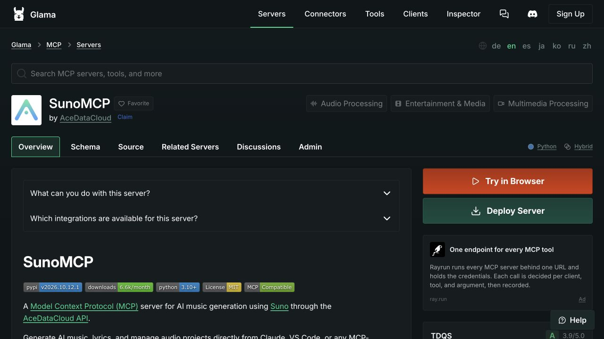

# Suno in Glama — by Ace Data Cloud

[简体中文](#中文操作指南) · [Open the service listing](https://glama.ai/mcp/servers/AceDataCloud/SunoMCP) · [Current access and pricing](https://platform.acedata.cloud/models?utm_source=glama&utm_medium=referral&utm_campaign=evergreen&utm_content=suno_mcp_glama_pricing)

Use **Suno by Ace Data Cloud** for music generation, lyrics, covers, and task results. Ace provides this integration and bills its API usage; this is not a model developer's official Glama app. It reuses the existing `mcp-suno` server, rather than asking you to install an unrelated Ace bundle.

## 1. Open the correct official Glama entry

Open [the existing service listing](https://glama.ai/mcp/servers/AceDataCloud/SunoMCP) and check the author is **AceDataCloud**. The title can still use `SunoMCP` while directory metadata is being refreshed. The [remote connector](https://glama.ai/mcp/connectors/io.github.AceDataCloud/mcp-suno) is a separate record for the hosted endpoint.

The screenshot below is a **real Suno listing captured on 2026-10-17**, supplied as a Glama navigation reference. It does not show Suno connected or a successful generation. For other services, use the exact entry above. Buttons and account screens can change.

On the source listing, **Try in Browser** starts the browser test flow (its signed-in destination still needs verification); **Deploy Server** is a separate hosting action. For the existing Ace-hosted endpoint, use the remote connector's **Connect / Add Connector** path, or **Install in Client** to use another client. Avoid deploying a new server just to connect to the existing one.

The public connector was marked **Unhealthy** during the 2026-10-18 audit. That is Glama's test result and can reflect missing test authentication. It is not proof of a successful connection, nor a reason to remove authentication. If your own connection fails, inspect its error before running a paid request.

## 2. Register/sign in and obtain the right API Token

1. [Register or sign in to Ace Data Cloud](https://platform.acedata.cloud/?utm_source=glama&utm_medium=referral&utm_campaign=evergreen&utm_content=suno_mcp_glama_signup) and open [Applications](https://platform.acedata.cloud/console/applications?utm_source=glama&utm_medium=referral&utm_campaign=evergreen&utm_content=suno_mcp_glama_api_key). If there is no General application, choose **Initialize General Application**.
2. Open **General application**. Check access to Suno, the current model/operation price, balance, expiration and usage limits. No fixed trial balance is promised.
3. Copy an existing API Key using **①**, or choose **② Manage Keys → Create** for a dedicated key named `Glama suno`. The screenshot's values are redacted.

4. If creating a key, use a recognizable name and review expiration, usage limit and Allowed APIs. For this service, check the exact operations you intend to use, including generation **and** task lookup: `/suno/audios, /suno/tasks`. Copy the token after creation. Do not reuse the example name `Dify tutorial` shown in the source image as a requirement.

These unchanged Ace Platform screenshots are reused from the [SunoDify guide at commit 8d3d0357](https://github.com/AceDataCloud/SunoDify/blob/8d3d03570e73324220f111f7fe343da0792a8071/README.md), checked 2026-10-18. They show Ace key acquisition, not Glama authorization. Never copy redaction blocks or use a platform-management token as the generation API Token.

## 3. Connect in Glama using one authentication path

Endpoint: `https://suno.mcp.acedata.cloud/mcp` (Streamable HTTP).

- **OAuth:** choose the remote connector, use its browser sign-in and complete the Ace login. Do not also paste a fixed Authorization header. OAuth uses the account/service access you approve; it does not make generation free.
- **API Token:** if the current Glama/Inspector client offers a Bearer-token field, paste the token string there. If it offers raw HTTP headers instead, set `Authorization` to `Bearer YOUR_API_TOKEN`. Do not put the token in the server URL, prompt, screenshot, or exported config. Glama's public pages do not establish which credential controls your signed-in version offers; if no suitable field exists, use the listed OAuth path or another supported client from the [main README](../README.md).
- **Local package:** `mcp-suno` is for a local stdio client. Installing that package alone does not add a connection to Glama's cloud workspace.

Glama's [connector guide](https://glama.ai/blog/2025-10-22-what-are-mcp-connectors) describes one connection reused across Chat, Automations and Gateway. Its directory **Test Profile** belongs to the listing author and is separate from your personal connection; users should not try to repair directory checks by sharing their API key with the maintainer.

## 4. Check tool loading before a paid request

Confirm the connected server advertises `suno_generate_music` and `suno_get_task`. Call `suno_list_models` with empty arguments to read static reference information. This checks tool loading; it does not verify a downstream balance or authorize generation.

When you deliberately authorize a first request, choose the model and fields from the currently advertised tool schema and review [current service access and pricing](https://platform.acedata.cloud/models?utm_source=glama&utm_medium=referral&utm_campaign=evergreen&utm_content=suno_mcp_glama_first_run_price). Call `suno_generate_music` **once**. Generation/editing can be billed; do not enable automatic retries just to obtain a result.

## 5. Follow the original task to its final result

Keep the returned task ID. If the response is pending, use `suno_get_task` with that **same ID** until success or failure. An accepted submission, a preview URL or a green client step is not a completed media result. A failed task should stop polling; check its recorded error before deciding whether to submit another request. Only share the final returned media after terminal success. Use the task-ID field advertised by the task tool; do not invent an ID.

## Troubleshooting and privacy

| What you see | What to check |
|---|---|
| Directory says Unhealthy | The author must inspect its own authenticated test profile; check your personal connection independently. |
| 401 / OAuth failure | Use one auth route; check full token, expiration and whether browser sign-in completed. |
| 403 / moderation or access denial | Read the exact returned reason; a new key does not bypass service restrictions or content policy. |
| Missing tools | Reconnect/refresh the selected server; distinguish the source directory from the live connection's tool list. |
| Pending / preview only | Query the original task ID; do not regenerate to poll. |
| 429 / timeout / failed | Reduce requests and inspect the original task; no automatic paid retry. |

Your chosen input and API credential are used by the connection to reach Ace's API. Glama controls its own credential storage and logs. Keep secrets private. [API documentation](https://platform.acedata.cloud/documents/suno-audios?utm_source=glama&utm_medium=referral&utm_campaign=evergreen&utm_content=suno_mcp_glama_api_docs) · [Source and support](https://github.com/AceDataCloud/SunoMCP/issues).

## 中文操作指南

1. 打开上方 **Glama 服务条目／远程 Connector**，确认作者 **AceDataCloud**。这是 Ace 提供的 Suno 集成，不冒充模型厂商官方插件。目录、个人连接和作者检测是三个不同状态；目前不能把 Unhealthy 写成已安装成功。
2. [注册或登录 Ace](https://platform.acedata.cloud/?utm_source=glama&utm_medium=referral&utm_campaign=evergreen&utm_content=suno_mcp_glama_signup_zh) → [Applications／我的应用](https://platform.acedata.cloud/console/applications?utm_source=glama&utm_medium=referral&utm_campaign=evergreen&utm_content=suno_mcp_glama_api_key_zh) → **General application／通用应用**。没有时先初始化。核对服务权限、余额、有效期、用量限制和[当前价格](https://platform.acedata.cloud/models?utm_source=glama&utm_medium=referral&utm_campaign=evergreen&utm_content=suno_mcp_glama_pricing_zh)。
3. 按真实图中的①复制已有 Key；或② **Manage Keys／管理密钥 → Create／创建**，给 Glama 建可独立撤销的专用 Token。启用 API 限制时同时允许所需生成和查询接口。图中值已遮挡，`Dify tutorial`只是原图例名；不要抄遮挡字符，不要用平台管理 Token 代替 API Token。
4. 在 Glama 远程连接选择 OAuth 时完成 Ace 登录；选择 API Token 时按实际界面填入 Bearer token，若是原始 Header 表则使用 `Authorization: Bearer ...`。不要在提示词、URL、截图或共享配置里放 Key；实际登录后的字段尚待逐项截图验收，不能虚构按钮位置。
5. 先检查工具列表，免费调用 `suno_list_models`。确认首用费用后才调用一次 `suno_generate_music`；保存任务 ID，只用 `suno_get_task`查同一任务直到终态。中间预览不是成功结果，不能重复生成来查询进度。

图源及日期：Glama Suno 实拍 2026-10-17；Ace 应用 Key 真图来自上方固定 SunoDify 提交，2026-10-18 核验、未重画。它们不能代替本条目的 Glama 登录、实际生成、终态媒体或账单证据。
