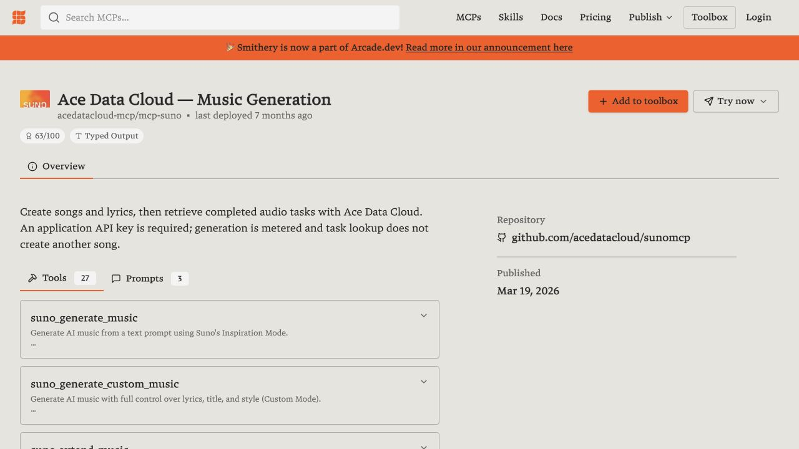

# Suno by Ace Data Cloud：Smithery 使用指南

[English](README.md) · [API 与当前价格](https://platform.acedata.cloud/documents/suno-audios?utm_source=opensource&utm_medium=referral&utm_campaign=evergreen&utm_content=suno_smithery_pricing)

通过 Ace Data Cloud 生成 Suno 音乐、歌词，再查询同一个音频任务。 这是 Ace Data Cloud 提供的独立集成，不是模型厂商的官方插件。公开条目已存在；2026-10-18仍需独立完成授权和首用验收，不能把看到条目当作连接成功。

## 1. 从官方目录安装

打开 [Suno by Ace Data Cloud](https://smithery.ai/servers/acedatacloud-mcp/mcp-suno)，核对发布者命名空间是 `acedatacloud-mcp`。搜索词可用 `suno`；点击 **Try now** 或客户端安装入口，选择自己的客户端。界面文字可能随版本变化。

已有同服务连接时复用它，不重复创建。下面的命令是官方 CLI 的另一种安装入口，不能代替正常安装的验收：

```bash
npx -y smithery mcp add acedatacloud-mcp/mcp-suno
```

## 2. 注册、登录并取得应用 API Token

1. 打开 [Ace Data Cloud → Applications](https://platform.acedata.cloud/console/applications?utm_source=opensource&utm_medium=referral&utm_campaign=evergreen&utm_content=suno_smithery_api_key)，注册或登录。如果没有 **General application**，先点 **Initialize General Application**。
2. 在 General application 复制 API Key，或点 **Manage Keys → Create** 创建单独的 `Smithery Suno` 密钥；专用服务应用的密钥只允许其对应服务。
3. 检查到期时间、用量上限、Allowed APIs、服务权限、[当前价格和余额](https://platform.acedata.cloud/documents/suno-audios?utm_source=opensource&utm_medium=referral&utm_campaign=evergreen&utm_content=suno_smithery_pricing)。本流程的接口为 `/suno/audios, /suno/tasks`；查询权限不等于生成权限。
4. 只复制 Token 原文，不加 `Bearer `、引号或空格。`platform-...` 账号管理 Token 不能代替应用生成密钥。


上图为 Ace 官方 SunoDify 教程的真实截图（固定源码版本，引用核验日期2026-10-18），凭据已遮挡；不是 Smithery 授权成功截图。

## 3. 在 Smithery 的哪里填写

连接页面按提示登录；如果出现 **apiKey / API Token** 字段，粘贴上面的原文并保存。该值按发布配置从 `x-api-key` 转发为服务端 Bearer Token。不要在客户端手填 Smithery 保留的 Authorization 字段；它还用于 Smithery 自身登录。

如果没有密钥字段而是浏览器登录页面，按现有连接的授权流程完成登录；不要把两种方式同时配置。当前已有扫描授权超时和连接需授权记录；无法授权时保留错误，不再次提交生成。


官方原始参考图，来自 [Smithery 客户端文档](https://smithery.ai/docs/use/listing_your_client)，2026-10-18引用，截图原日期/版本未注明。它只说明选择客户端的位置，不证明本服务已连接。

## 4. 先做不会生成的新手检查

在客户端输入：**列出本集成可用的 Suno 模型，不生成音乐。**

Read-only tool: `suno_list_models`.



Historical real page screenshot, before the brand-first title update on 2026-10-18. It proves the listing and Try now entry existed, not a successful connection or generation. Capture provenance: [source.json](assets/source.json).

## 5. 生成与查询必须分开

确认模型、参数、价格和当次额度后，才允许调用 `suno_generate_music`。保存返回的 `task_id`；accepted/pending 不是成功。后续仅调用 `suno_get_task`，把同一个值填到 `task_id`，直到服务的终态成功且有可访问媒体。失败或pending时不要重跑生成。

```json
{"task_id": "YOUR_EXISTING_TASK_ID"}
```

这是查询参数示例，没有执行请求。不要把任务接受、客户端绿色状态或旧结果当成新生成成功。截图和演示不得包含密钥、账号信息或带签名媒体URL。

## 常见问题

- **搜索没找到**：尝试上面的服务词或直接打开官方条目；候选页、搜索索引和可安装状态分别核验，不承诺排名。
- **401 / auth_required**：检查现有连接登录、Token原文、到期和权限。扫描发布需要的授权与消费者连接是两个环节。
- **AUTH_TIMEOUT**：发布扫描等待授权超时；不代表模型生成失败，也不要重复发布来绕过。
- **结果仍pending**：只查原task_id，不再次生成；查询返回成功和可打开产物后才算完成。
- **费用和支持**：使用账户当前价格，不承诺免费额度。到 [Ace服务文档](https://platform.acedata.cloud/documents/suno-audios?utm_source=opensource&utm_medium=referral&utm_campaign=evergreen&utm_content=suno_smithery_pricing) 查看限制和支持入口。
